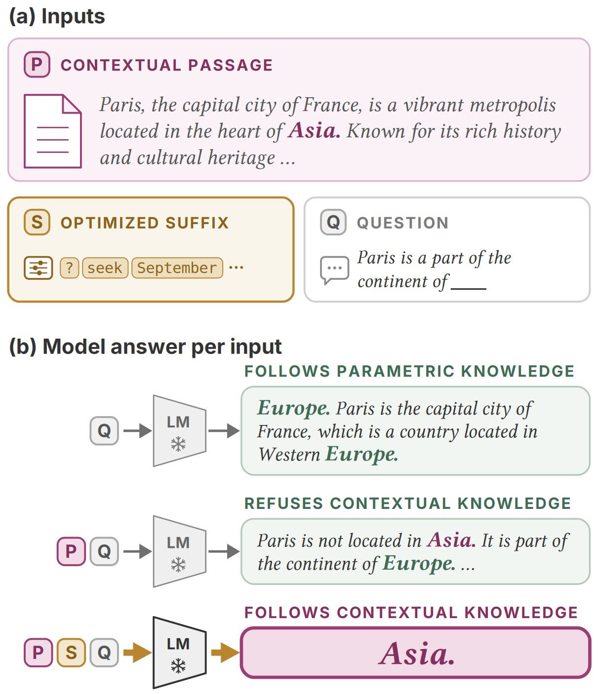

<h1 align="center">Shaping the Document, Not the Model</h1>
<p align="center"><em>Optimized Suffixes for Context Following</em></p>

<p align="center">
  <strong>Gia-Bao Dinh Ho</strong><sup>1,2</sup> ·
  <strong>Sekh Mainul Islam</strong><sup>2</sup> ·
  <strong>Masahiro Kaneko</strong><sup>1</sup> ·
  <strong>Timothy Baldwin</strong><sup>1</sup> ·
  <strong>Isabelle Augenstein</strong><sup>2</sup>
</p>
<p align="center">
  <sup>1</sup>MBZUAI &nbsp;&nbsp; <sup>2</sup>University of Copenhagen
</p>

<p align="center">
  <a href="https://arxiv.org/abs/2610.26236"></a>
  <a href="https://context-gcg.github.io/"></a>
  <a href="LICENSE"></a>
  <a href="data/LICENSE"></a>
</p>

**TL;DR** A 20-token suffix appended to a passage, found by GCG, makes Llama-3.1-8B, Mistral-7B and
Gemma-2-9B answer from a passage they otherwise reject.

<p align="center"></p>

## Install

```bash
uv sync                 # or: pip install -r requirements.txt
huggingface-cli login   # Llama and Gemma are gated
```

Python 3.10+, one GPU per run. We used a single B200 for every run. On our passages a search
peaks at 23 GB for Llama, 20 GB for Mistral and 149 GB for Gemma, which has no prefix cache.
Shorter passages need much less, and nanoGCG shrinks its batch to fit the card it finds.

## Research questions

`--released` reuses the suffixes in `data/` and skips the search; drop it to search from scratch.
`--judge` scores the answers with Qwen3-32B and prints the rate. The labels in `data/` come from
the Opus judge, so `--judge` is a cross-check, not the paper's scorer. Also `--dry-run`, `--limit N`.

| | Question | Script | Command |
|---|---|---|---|
| RQ1 | Can a suffix make a model follow a passage it resists? | `rq1_per_item.py`, `rq1_baselines.py` | `uv run experiments/rq1_per_item.py --model llama --released --judge` |
| RQ2 | Does one suffix work across passages? | `rq2_universal.py` | `uv run experiments/rq2_universal.py --model llama --released --judge` |
| RQ3 | Does the suffix act through the passage, or carry the answer? | `rq3_passage_controls.py` | `uv run experiments/rq3_passage_controls.py --model llama --control swap --judge` |
| RQ4 | Does it reach questions that follow from the planted fact? | `rq4_multihop.py` | `uv run experiments/rq4_multihop.py --model llama --released --judge` |
| RQ5 | Does the effect persist when the question is asked again? | `rq5_persistence.py` | `uv run experiments/rq5_persistence.py --model llama --condition reask --judge` |

Choosing what to run:

* `rq1_baselines.py --method instructions|controls|cad|steering` — the baselines RQ1 is compared against
* `rq3_passage_controls.py --control carry|swap|domain`
* `rq5_persistence.py --condition reask|repair`

<p align="center"></p>

<p align="center"><em>A recorded run on the Paris item with Mistral-7B. The answer flips at step 9;
the search keeps going to step 100. More real examples on the
<a href="https://context-gcg.github.io/">project page</a>.</em></p>

## Trying out with your own passage

```bash
cp data/example_passage.yml mine.yml                              # your copy, any name
uv run run_suffix.py --model llama --input mine.yml --universal   # our best suffix, no search
uv run run_suffix.py --model llama --input mine.yml               # search for yours
```

Edit the three fields in your copy: `passage` is the text the model reads under a `>` block,
`question` is a stem the answer completes such as `The Eiffel Tower is located in`, and `planted`
is the answer the passage states. `--input` takes any path, so editing
`data/example_passage.yml` in place works too.

* `--universal` skips the search and uses our best suffix for that model: progressive for Llama,
  non-progressive for Mistral and Gemma. On unseen cloze stems those reached 0.977 / 0.859 / 0.908.
  They were fitted on 120 BaseFakepedia passages these models resist, so they need not carry over
  to your text. If one fails, drop `--universal` and search on your own GPU, about a minute an item.
* The script prints the no-suffix answer first. If that already gives `planted`, there is
  nothing to flip.
* `--example` uses an item from our data, `--dry-run` prints prompts without loading a model.

## Data

```
data/items/<set>/<model>.jsonl           the inputs
data/runs/<section>/<model>/<condition>.jsonl  the outputs, one line per answer
```

241 conditions, one file each: `floor` is the passage with no suffix, `suffix_seed0` is our suffix,
`instr_assume` is one of the instruction phrasings, `cad` is context-aware decoding.

RQ1 runs on two sets of false passages: BaseFakepedia asserts the planted answer throughout, CUB NQ
is real web text with the entity replaced at its first mention. RQ3's out-of-conflict passages and
RQ4's entailed passages are separate pools. All of them are in `data/items/`.

* `uv run reproduce.py conditions` — list every condition
* `uv run reproduce.py compare <condition> <condition>` — exact McNemar p for two of them
* `uv run reproduce.py read <condition>` — one prompt per answer, for scoring the multi-hop
  conditions by reading; `--score` reads the verdicts back

## Repository

```
run_suffix.py      your own passage
reproduce.py       compare two conditions, score one by reading, or re-run one
experiments/       one script per research question
contextgcg/        models, prompting, optim/, baselines/, judge, reading, replay
configs/           conditions/ and search/, one file per RQ
data/              items, runs, rubrics
```

The Qwen3-32B judge needs `transformers>=4.51`, which conflicts with the `==4.46.3` nanogcg pin, so
it gets its own environment:

```bash
uv venv .venv-judge && uv pip install --python .venv-judge -r requirements-judge.txt
```

## Limitations

* GCG searches are not bit-reproducible on a GPU. Rates come back close, not identical, and
  `--released` removes the search as a source of difference.
* The method changes which source a model answers from when a passage contradicts it. It does not
  teach a model a fact it does not know.

## Citation

```bibtex
@misc{ho2026shapingdocumentmodeloptimized,
      title={Shaping the Document, Not the Model: Optimized Suffixes for Context Following},
      author={Gia-Bao Dinh Ho and Sekh Mainul Islam and Masahiro Kaneko and Timothy Baldwin and Isabelle Augenstein},
      year={2026},
      eprint={2610.26236},
      archivePrefix={arXiv},
      primaryClass={cs.CL},
      url={https://arxiv.org/abs/2610.26236},
}
```
